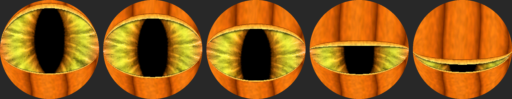

# Lesson 06 — Pumpkin-flesh eyelids (jack-o'-lantern eye)

**Goal:** the eye will sit inside a carved pumpkin, so the black eyelids become pumpkin flesh — and
without giving back the frame rate.



## The idea: texture by depth into the lid
A pixel is under the upper lid when `upper[y][x] <= uT`, so **`depth = uT − upper[y][x]`** says how far
inside the lid it is, measured from the lid's *moving* edge. Indexing the texture as
`lidTex[depth][x]` makes the texture slide with the lid; a texture fixed to the screen would look like
a window wiping over a still picture. Where both lids cover a pixel (a closed blink), the nearer edge
wins, so the two glowing edges meet as a bright seam.

| depth | look |
|---|---|
| 0–16 | cut edge: glowing yellow flesh with faint fibres — lit from inside, like a carved pumpkin |
| ~17 | thin dark rind line |
| deeper | orange skin: rounded ribs lit from the left, darker grooves, fine grain |

Uncovered pixels within 10 units of a lid edge are darkened (up to 20/32): the lid's **shadow** on the
eye, which makes the lids sit in front.

## Designing on the PC first
`scripts/gen_lids.py` builds the texture with numpy and renders a **preview with the same maths as
`drawEye()`** (it imports `gen_eye.build()`, refactored out of `gen_eye.py` — output checked
byte-identical). Iterations happened on the preview, not by reflashing:
1. First pass read as wood grain: ribs too regular, comb-like fibres at the edge.
2. Rounded bulge per rib, slow sway, softer grain, wider glow → "looks like pumpkin".
3. Feedback "too many vertical lines — fewer and irregular": grooves placed at random gaps of
   65–110 px (≈ 3 grooves) instead of every 56 px.

## Speed: where the tables live
First result: render **~40 ms** vs ~35 predicted (15.5 fps, from 18). Flash is read through a small
cache, and the texture added another 120 KB table hit all over the frame.

The first "after" measurement compared different workloads (the eye happened to look up — lids wide
open, more iris), so a **fixed benchmark** was added at startup: the same frame 10× per variant, only
the table location changing:

| Variant | Render |
|---|---|
| A: all tables in flash | 41.2 ms |
| B: lid texture → internal RAM | 34.5 ms (predicted 31–33 ✗) |
| C: + `upper`/`lower` lid maps → internal RAM | **29.4 ms** |

The bigger win was the lid maps (56 KB each), read for **every** pixel, not the texture I suspected.
Result: **~19.6 fps with pumpkin lids** — faster than the black lids were (18). Internal RAM after the
copies: 122 KB free. Copies use `heap_caps_malloc(…, MALLOC_CAP_INTERNAL)` — plain `malloc` may return
PSRAM here — and fall back to the flash tables if the allocation fails.

## Bug: StoreProhibited at address 0
The benchmark crashed in a boot loop: `Guru Meditation Error: Core 1 panic'ed (StoreProhibited)`,
`EXCVADDR: 0x00000000` — a *write* to address 0, i.e. through a null pointer. `addr2line` on the
backtrace: `drawEye` (main.cpp:67) ← `bench` (362) ← `setup`, while `fb` was allocated at line 365.
The benchmark ran before the frame buffer existed. Fix: allocate `fb` straight after `panel.begin()`.

## C++ for Python people
- `const uint16_t (*lid)[240] = lidTex;` — a pointer to rows of 240, so `lid[depth][x]` indexes exactly
  like the 2-D table; repointing it at the RAM copy changes nothing else in `drawEye`.
- `auto bench = [&](const char *name) { … };` — a lambda, like a Python nested function; `[&]` lets it
  use the surrounding variables by reference.
- A null-pointer write doesn't raise a catchable exception like `AttributeError` — the CPU traps and
  the chip reboots. The backtrace + `addr2line` is the traceback.

## Cheat-sheet
```bash
scripts/.venv/bin/python scripts/gen_lids.py art/dragonEye include/lid_pumpkin.h docs/img/pumpkin-lids.png
~/.platformio/packages/toolchain-xtensa-esp32s3/bin/xtensa-esp32s3-elf-addr2line -pfiaC -e .pio/build/t-rgb/firmware.elf <addr> …
```
Tuning knobs in `gen_lids.py`: `RIB_GAP`, `EDGE`, `SHADOW`/`SHADOW_MAX`, colours, `SEED`.
