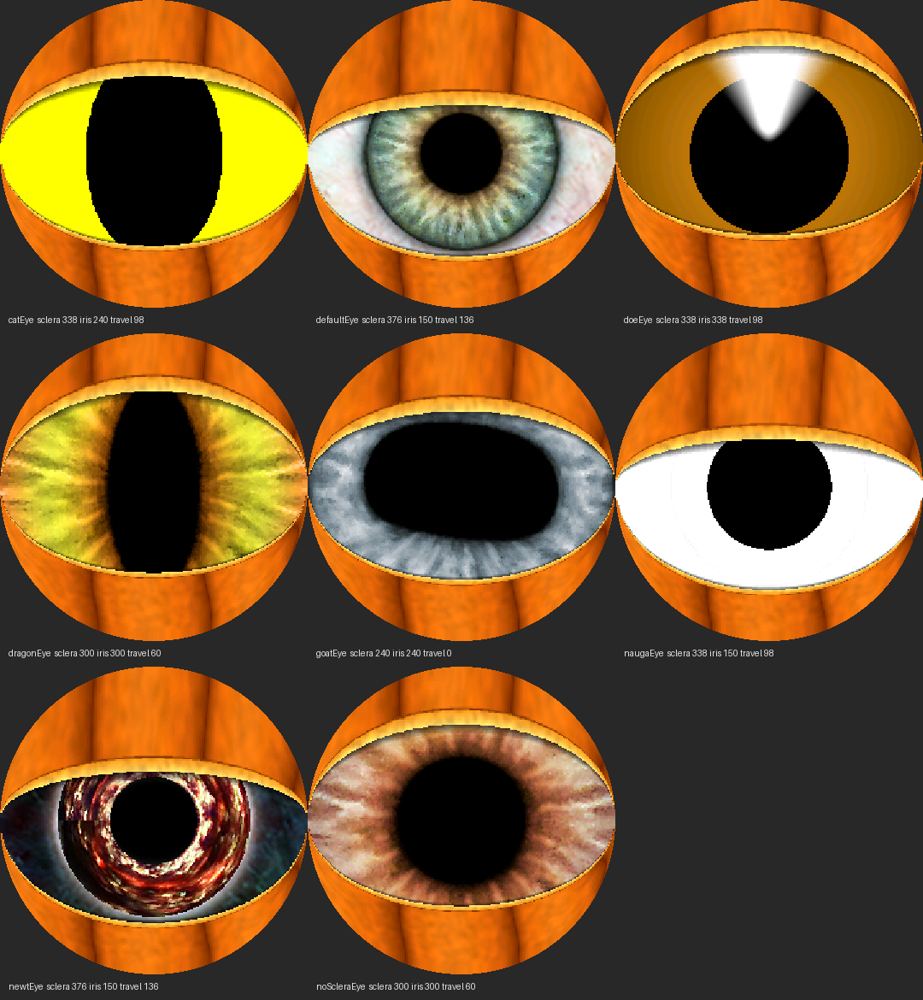

# Lesson 09 — Eight eyes, one pumpkin

**Goal:** all of Adafruit's Uncanny Eyes designs that work with eyelids, switchable by a 2 s press,
with the choice remembered across power cycles.

## The designs
Rendered on the PC first (`scripts/preview_eyes.py`, the numpy mirror of `drawEye`):

| Design | Sclera (px at 240) | Iris | Pupil range | Note |
|---|---|---|---|---|
| dragonEye | 300 | 300 | 80–400 | slit pupil (pupil map) |
| noScleraEye | 300 | 300 | 120–550 | all iris |
| catEye | 338 | 240 | 100–600 | flat colours, 1×1 iris texture |
| goatEye | 240 | 240 | 120–720 | sclera = screen size → **travel 0**, the eye can't move (same in Adafruit's original) |
| defaultEye | 376 | 150 | 120–720 | human; most travel (136 px) |
| newtEye | 376 | 150 | 180–750 | |
| doeEye | 338 | 338 | 250–500 | no symmetrical lids → uses the plain ones |
| naugaEye | 338 | 150 | 300–1023 | googly; IRIS_MAX 1023 (see the guard below) |

**Left out: terminatorEye** — its lid maps are 255 everywhere, and a pixel is only covered when
`map <= threshold` (max 254), so it has no eyelids: it can't blink or flinch. The first preview showed
it as solid pumpkin because the lid-tracking sample read 255 → "fully shut".

## Generator changes (`scripts/gen_eye.py`)
- A `DESIGNS` table with each design's iris diameter and pupil range, copied from Adafruit's
  `uncannyEyes/graphics/*.h`.
- **Round pupils:** designs without `pupilMap.png` get distance-from-centre, as Adafruit's `tablegen.py`.
- **Lids:** falls back to `lid-upper.png` / `lid-lower.png` when there's no symmetrical version.
- **Optional namespace** (4th argument): wraps a design's tables in `namespace catEye { ... }` and adds
  its `IRIS_MIN` / `IRIS_MAX`. Without it the output is byte-identical to before (checked with `cmp`),
  so older stage snapshots still regenerate.
- `scripts/gen_all_eyes.sh` writes all eight to `include/eyes/` (**not in git**: ~16 MB of hex; the
  flash cost is ~3.8 MB). Run it after cloning.

## Firmware changes
- **`EyeDesign` table** — name, sizes, and pointers to the five tables. The `EYE(ns)` macro fills one
  entry from a namespace, so adding a design is one `#include` and one `EYE(...)`.
- **2D arrays → pointer + width.** Each design's tables are a different size, so `sclera[y][x]`
  becomes `sclera[y * SC + x]`. `drawEye()` copies `eye->...` into locals first so the compiler can keep
  them in registers.
- **Per-design ranges:** pupil walk (`PupilWalk::setRange`), eye travel (`scleraSize - 240`, 0 for the
  goat), lid tracking sample point.
- **Switch:** `selectDesign(i)` repoints `eye`, copies the design's lid maps into the same internal-RAM
  buffers (115 KB, the stage 6 speed-up), restarts the pupil walk.
- **Long press:** a finger counts as "down" until 200 ms without a touch report; after 2 s down → next
  design, once per press. The lids are forced shut (closure 1) for 0.25 s starting that frame, so the
  swap happens behind closed lids.
- **Remembered:** `Preferences` (`prefs.putUChar("design", i)` / `getUChar("design", 0)`).

## Predictions vs results
| Prediction | Result |
|---|---|
| render +0–2 ms (sizes now run-time variables) | ~+1–3 ms (45–47 → ~48 ms); fps unchanged ~20 (push is the bottleneck) — roughly held |
| without a guard, nauga divides by zero (`irisThreshold` = 0 at iScale 1023) | guard `max(1, …)` added; nauga runs, no reboot ✓ |
| maybe a display glitch at the switch (flash write stalls the caches; the RGB panel streams from PSRAM) | none reported |
| all eight cycle by long press, one switch per press | ✓ "cycled through, all reactive" |
| RST comes back on the same design | ✓ "reset remembers" |
| flash: ~0.5 MB per design | 1.0 → 4.37 MB of the 6.5 MB app partition |

Soak while idle: 320 s, 0 reboots; the serial transmitter stalled twice and the stage 8 kick recovered
it both times (`kicks 2`).

## Small fix found on the way
`vsnprintf` returns the length the string *would* have had, not what fit. `logf()` then did
`Serial.write(buf, n)` — with a line over 200 bytes it would read past the end of `buf`. Now
`n = min(n, sizeof(buf) - 1)`. (Never triggered: the lines were ~170 bytes, but the design name was
about to make them longer.)

## C++ for Python people
- `namespace catEye { const uint16_t sclera[...]; }` ≈ a Python module: `catEye::sclera` and
  `dragonEye::sclera` don't collide, like `cat.sclera` and `dragon.sclera`.
- `#define EYE(ns) { #ns, ns::SCLERA_SIZE, ... }` — a macro is text substitution before compiling;
  `#ns` turns the argument into a string (`"catEye"`). Python has no equivalent; think of it as a
  code template the compiler pastes in.
- `&ns::sclera[0][0]` — the address of the first element: turns a fixed-size 2D array into a plain
  `const uint16_t *` that works for any size.
- `Preferences` ≈ `shelve`: a tiny persistent dict in flash. `begin("eye")` picks a namespace,
  `getUChar(key, default)` reads, `putUChar(key, value)` writes (a flash write, a few ms).
- `sizeof(designs) / sizeof(designs[0])` — number of array elements (like `len()`, computed at compile time).
